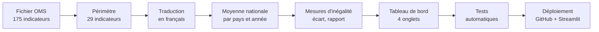

# Maladies chroniques en Afrique de l'Ouest : un tableau de bord interactif


**Application en ligne :https://dashboard-sante-equite-c5cwxkfwypb98jmsxbh9nc.streamlit.app/** 
> **English summary.** Interactive dashboard (Streamlit + Plotly) on chronic diseases in eight West African countries
> (Benin, Burkina Faso, Côte d'Ivoire, Ghana, Mali, Niger, Senegal, Togo), built from a WHO health-equity extract.
> It keeps 29 indicators (hypertension, diabetes, cholesterol, NCD mortality, physical activity) out of 175, shows
> trends from 1980 to 2022 and the female–male gap, and is fully in French. In 2019, on simple average over the eight
> countries, about 40 % of hypertensive adults were diagnosed, 25 % treated and 11 % controlled.
> The detailed write-up below is in French.

**Le problème.** Le fichier de l'OMS compte 175 indicateurs de santé : impossible d'y lire d'un coup d'œil l'évolution
des maladies chroniques, les écarts entre pays ou la différence entre femmes et hommes.
**Les données.** 13 626 lignes, 8 pays, 29 indicateurs, de 1980 à 2022, avec une seule dimension d'inégalité : le sexe.
**La méthode.** Sélection du périmètre, traduction en français, calcul de la moyenne nationale, mesures d'inégalité
(écart absolu, rapport), puis visualisation interactive testée automatiquement.
**Le résultat.** Un tableau de bord à quatre onglets, entièrement en français, déployable en un clic et mis à jour à
chaque `git push`.

## Pourquoi c'est important

Pour l'hypertension, la prévalence ne dit pas tout : ce qui compte, c'est la part des malades repérés, soignés, puis
dont la tension est contrôlée. Le tableau de bord met cette chaîne de soins en regard des écarts entre pays et entre
sexes, pour repérer où l'effort de dépistage ou de traitement fait le plus défaut.

## Les chiffres clés

Valeurs du fichier, **standardisées selon l'âge**, dernière année disponible (hypertension : adultes de 30 à 79 ans,
2019 ; diabète : 18 ans et plus, 2022 ; mortalité : 2021).

| Pays | Hypertension : prévalence (%) | Hypertendus à tension contrôlée (%) | Diabète : prévalence (%) | Mortalité par MNT (pour 100 000) |
|---|---|---|---|---|
| Bénin | 31,2 | 9,3 | 12,1 | 590,5 |
| Burkina Faso | 30,5 | 8,9 | 12,3 | 638,6 |
| Côte d'Ivoire | 37,3 | 8,6 | 11,3 | 600,2 |
| Ghana | 33,9 | 19,1 | 10,4 | 606,4 |
| Mali | 34,6 | 14,5 | 8,4 | 618,3 |
| Niger | 41,5 | 6,1 | 6,2 | 567,4 |
| Sénégal | 40,5 | 9,5 | 8,2 | 595,8 |
| Togo | 36,0 | 9,4 | 9,5 | 686,5 |
| **Moyenne simple** | **35,7** | **10,7** | **9,8** | **613,0** |

*MNT : maladies non transmissibles. La moyenne simple n'est pas pondérée par la population des pays.*

**Chaîne de soins de l'hypertension (2019, moyenne simple des 8 pays, en % des adultes hypertendus) :**
diagnostiqués 40,5 → traités 24,6 → tension contrôlée 10,7.

**Écart femmes − hommes (points de pourcentage, dernière année par pays) :**

| Indicateur | Femmes plus élevées | Écart moyen | Étendue |
|---|---|---|---|
| Prévalence de l'hypertension | 8 pays sur 8 | +3,9 | de +0,7 (Côte d'Ivoire) à +7,8 (Mali) |
| Hypertendus à tension contrôlée | 8 pays sur 8 | +5,3 | de +2,1 (Bénin) à +10,2 (Ghana) |
| Prévalence du diabète | 6 pays sur 8 | +0,7 | de −1,2 (Burkina Faso) à +1,9 (Mali) |

*Ces écarts sont des différences brutes entre estimations ; ils n'ont pas fait l'objet d'un test statistique.*

## La chaîne de traitement des données



| Étape | Ce qui a été fait | Résultat | Outils |
|---|---|---|---|
| 1. Données sources | Conversion du classeur Excel en CSV compressé | 39 632 lignes, 725 Ko | pandas (`scripts/prepare_data.py`) |
| 2. Périmètre | Sélection, par code, des indicateurs de maladies chroniques | 175 → 29 indicateurs ; 13 626 lignes | `traductions.py` |
| 3. Traduction | Libellés des indicateurs, pays, dimension et sous-groupes ; nombres au format français | Interface 100 % française, vérifiée par un test | `traductions.py`, pytest |
| 4. Moyenne nationale | La moyenne nationale, répétée sur chaque sous-groupe dans le fichier, est dédoublonnée | Une valeur par pays, indicateur et année | pandas |
| 5. Inégalités | Écart absolu (max − min) et rapport (max / min) entre sous-groupes ; intervalles de confiance à 95 % | Suivi des écarts dans le temps | pandas, Plotly |
| 6. Visualisation | Carte, classement, tendances, inégalités, tableau et export CSV | Quatre onglets interactifs | Streamlit, Plotly |
| 7. Tests | Démarrage, affichage de chaque sous-thème, absence de texte anglais dans l'interface et les graphiques | 3 tests | pytest, GitHub Actions |
| 8. Déploiement | Dépôt GitHub relié à Streamlit Community Cloud | Mise à jour automatique à chaque `git push` | Streamlit Community Cloud |

## Le tableau de bord en bref

**Filtres.** Sous-thème (hypertension, diabète, cholestérol, mortalité par maladies chroniques, activité physique),
indicateur, pays et période.

1. **Vue d'ensemble.** Valeur la plus récente par pays (avec sa variation), carte et classement ; les couleurs
   tiennent compte du sens favorable ou défavorable de l'indicateur.
2. **Tendances.** Courbes par pays et variation entre la première et la dernière année.
3. **Inégalités.** Comparaison femmes–hommes avec intervalles de confiance, puis évolution de l'écart absolu ou du
   rapport.
4. **Données.** Tableau filtré et export CSV au format français (séparateur « ; », virgule décimale).

## Ce que j'en retiens

- **Une seule dimension d'inégalité.** Pour ces 29 indicateurs, le fichier ne distingue que les femmes et les hommes :
  rien sur le milieu urbain ou rural, la richesse ou l'âge. Les inégalités sociales ne sont donc pas mesurées ici.
- **Des périodes différentes selon l'indicateur.** Cholestérol jusqu'en 2018, hypertension jusqu'en 2019, mortalité
  jusqu'en 2021, diabète et activité physique jusqu'en 2022. La mortalité par cancer n'a qu'une seule année (2019) :
  pas de tendance possible. Comparer des pays sur une même année, pas des indicateurs entre eux.
- **Des moyennes simples.** Les moyennes « 8 pays » ne sont pas pondérées par la population.
- **Méthode d'estimation non vérifiée.** Les valeurs sont celles du fichier source. Je n'ai pas contrôlé, indicateur
  par indicateur, s'il s'agit d'enquêtes ou de modèles : à vérifier dans la documentation de l'OMS avant toute
  publication.
- **Cholestérol HDL.** Le fichier le marque comme « défavorable » alors qu'un HDL élevé est plutôt bon : sa couleur
  vert/rouge est inversée pour ce seul indicateur. La valeur d'origine a été conservée.

## Reproduire le projet

```bash
git clone https://github.com/ismaelkodjo/dashboard-sante-equite.git
cd dashboard-sante-equite
pip install -r requirements.txt
streamlit run app.py           # ouvre http://localhost:8501
pytest -q tests                # 3 tests
```

Pour utiliser un autre fichier au même format OMS : `python scripts/prepare_data.py chemin/fichier.xlsx`, puis ajouter la
traduction des nouveaux indicateurs dans `traductions.py`. Colonnes obligatoires : `setting, date, indicator_abbr,
indicator_name, dimension, subgroup, estimate, ci_lb, ci_ub, setting_average, iso3, favourable_indicator,
subgroup_order`.

```
dashboard-sante-equite/
├── README.md
├── app.py                       # application Streamlit
├── traductions.py               # périmètre (29 indicateurs) et libellés français
├── requirements.txt
├── data/
│   ├── data_nettoye.csv.gz      # données utilisées par l'application
│   └── raw/data_nettoye.xlsx    # fichier d'origine (175 indicateurs)
├── scripts/prepare_data.py      # conversion Excel -> CSV compressé
├── tests/test_app.py
├── .streamlit/config.toml       # thème et options d'affichage
└── .github/workflows/ci.yml     # tests automatiques à chaque push
```

Outils : Python · pandas · Plotly · Streamlit · pytest · GitHub Actions · Streamlit Community Cloud.

## Auteur, licence et données

**Auteur :** Nanliebe SAKPANI · www.linkedin.com/in/nanliebe-sakpani-89a5b2284 · sakpanikodjo@gmail.com 
Code sous licence MIT. Les données proviennent de l'Organisation mondiale de la santé (OMS), Boîte à outils
d'évaluation de l'équité en santé (HEAT) ; leur réutilisation reste soumise aux conditions de la source.
