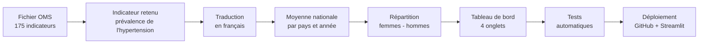

# Prévalence de l'hypertension en Afrique de l'Ouest : un tableau de bord interactif


**Application en ligne : https://VOTRE-APP.streamlit.app** *(remplacer par l'adresse obtenue après le déploiement)*

> **English summary.** Interactive dashboard (Streamlit + Plotly) on one indicator: hypertension prevalence among
> adults aged 30–79 (age-standardized), 1990–2019, in eight West African countries (Benin, Burkina Faso, Côte
> d'Ivoire, Ghana, Mali, Niger, Senegal, Togo), built from a WHO health-equity extract. The simple average over the
> eight countries is stable (35.8 % in 1990, 35.7 % in 2019) but country trends diverge, and prevalence is higher
> among women than men in all eight countries. The interface is fully in French; the detailed write-up below is too.

**Le problème.** Le fichier de l'OMS compte 175 indicateurs de santé. Pour comprendre l'hypertension, il faut en isoler
un seul, bien défini, et le lire dans le temps, entre pays et entre femmes et hommes.
**Les données.** 480 lignes : 8 pays × 30 années (1990 à 2019) × 2 sexes, pour l'indicateur « Prévalence de
l'hypertension, adultes de 30 à 79 ans (%) », standardisé selon l'âge.
**La méthode.** Sélection de l'indicateur, traduction en français, calcul de la moyenne nationale, écart
femmes − hommes, puis visualisation interactive testée automatiquement.
**Le résultat.** Un tableau de bord à quatre onglets, entièrement en français, déployable en un clic et mis à jour à
chaque `git push`.

## Pourquoi c'est important

L'hypertension est l'un des principaux facteurs de risque cardiovasculaire. Comparer sa prévalence entre pays, suivre
son évolution sur trois décennies et mesurer l'écart entre femmes et hommes aide à repérer où elle progresse et quels
publics sont les plus touchés.

## Les chiffres clés

Prévalence de l'hypertension chez les adultes de 30 à 79 ans, en %, **standardisée selon l'âge**.

| Pays | 1990 | 2019 | Variation (points) | Femmes 2019 | Hommes 2019 | Écart femmes − hommes |
|---|---|---|---|---|---|---|
| Bénin | 33,9 | 31,2 | −2,7 | 33,0 | 28,9 | +4,1 |
| Burkina Faso | 32,2 | 30,5 | −1,7 | 31,7 | 29,1 | +2,6 |
| Côte d'Ivoire | 36,6 | 37,3 | +0,7 | 37,6 | 36,9 | +0,7 |
| Ghana | 35,3 | 33,9 | −1,4 | 36,1 | 31,4 | +4,7 |
| Mali | 34,1 | 34,6 | +0,5 | 38,3 | 30,5 | +7,8 |
| Niger | 40,2 | 41,5 | +1,3 | 42,6 | 40,4 | +2,2 |
| Sénégal | 38,4 | 40,5 | +2,1 | 42,9 | 37,3 | +5,6 |
| Togo | 35,6 | 36,0 | +0,4 | 37,5 | 34,3 | +3,2 |
| **Moyenne simple** | **35,8** | **35,7** | **−0,1** | | | **+3,9** |

- **En 2019**, la prévalence va de 30,5 % au Burkina Faso à 41,5 % au Niger.
- **De 1990 à 2019**, la moyenne des 8 pays est quasi stable, mais les trajectoires divergent : baisse au Bénin, au
  Burkina Faso et au Ghana ; hausse dans les cinq autres pays, la plus nette au Sénégal (+2,1 points).
- **Femmes et hommes** : la prévalence est plus élevée chez les femmes dans les 8 pays, de +0,7 point en Côte d'Ivoire à
  +7,8 points au Mali.

*La moyenne simple n'est pas pondérée par la population. Les écarts sont des différences brutes entre estimations et
n'ont pas fait l'objet d'un test statistique.*

## La chaîne de traitement des données



| Étape | Ce qui a été fait | Résultat | Outils |
|---|---|---|---|
| 1. Données sources | Extraction de l'indicateur depuis le fichier OMS (175 indicateurs), enregistré en CSV compressé | 480 lignes | pandas (`scripts/prepare_data.py`) |
| 2. Indicateur | Sélection par code (`NCD_HYP_PREVALENCE_A`) ; aucune autre donnée n'est conservée dans le dépôt | 175 → 1 indicateur | `traductions.py` |
| 3. Traduction | Libellés de l'indicateur, des pays, de la dimension et des sous-groupes ; nombres au format français | Interface 100 % française, vérifiée par un test | `traductions.py`, pytest |
| 4. Moyenne nationale | La moyenne nationale, répétée sur chaque sous-groupe dans le fichier, est dédoublonnée | Une valeur par pays et par année | pandas |
| 5. Répartition selon le sexe | Prévalence par sexe, écart femmes − hommes par pays et dans le temps | Comparaison par sexe, dernière année et évolution | pandas, Plotly |
| 6. Visualisation | Carte, classement, tendances, répartition selon le sexe, tableau et export CSV | Quatre onglets interactifs, charte graphique soignée | Streamlit, Plotly, CSS |
| 7. Tests | Démarrage, 8 pays affichés, absence de texte anglais, un seul indicateur dans les données | 5 tests | pytest, GitHub Actions |
| 8. Déploiement | Dépôt GitHub relié à Streamlit Community Cloud | Mise à jour automatique à chaque `git push` | Streamlit Community Cloud |

## Le tableau de bord en bref

**Filtres.** Pays et période (1990–2019).

L'en-tête affiche le titre de l'indicateur en gras, puis une synthèse en une phrase (moyenne des pays, valeurs
extrêmes, écart entre femmes et hommes). Une carte par pays indique ensuite l'évolution depuis 1990 (augmentation ou
diminution, en points de pourcentage). Femmes et hommes ont chacun leur couleur dans tout le tableau de bord.

1. **Vue d'ensemble.** Carte avec échelle de couleurs et classement des pays ; les couleurs tiennent compte du fait
   qu'une prévalence élevée est défavorable.
2. **Tendances.** Courbes par pays et variation entre la première et la dernière année.
3. **Femmes et hommes.** Évolution par sexe en moyenne, puis pays par pays (graphiques en courbes), et écart
   femmes − hommes.
4. **Données.** Tableau filtré et export CSV au format français (séparateur « ; », virgule décimale).

## Ce que j'en retiens

- **Un seul indicateur.** Le tableau de bord ne dit rien du diagnostic, du traitement ni du contrôle de l'hypertension :
  il mesure uniquement sa prévalence.
- **Une seule dimension d'inégalité.** Le fichier ne distingue que les femmes et les hommes : rien sur le milieu
  urbain ou rural, la richesse ou l'âge.
- **Une période qui s'arrête en 2019.** Aucune donnée plus récente pour cet indicateur dans le fichier.
- **Version standardisée selon l'âge.** Elle sert à comparer des pays à structures d'âge différentes. La version
  « valeurs brutes » (`NCD_HYP_PREVALENCE_C`) existe dans le fichier mais n'est pas utilisée.
- **Méthode d'estimation non vérifiée.** Les valeurs sont celles du fichier source. Je n'ai pas contrôlé s'il s'agit
  d'enquêtes ou de modèles : à vérifier dans la documentation de l'OMS avant toute publication.

## Reproduire le projet

```bash
git clone https://github.com/ismaelkodjo/dashboard-sante-equite.git
cd dashboard-sante-equite
pip install -r requirements.txt
streamlit run app.py           # ouvre http://localhost:8501
pytest -q tests                # 5 tests
```

Le fichier OMS d'origine (175 indicateurs) n'est pas inclus dans le dépôt. Pour régénérer les données ou changer
d'indicateur (par exemple la version brute) : modifier `CODE` et `LIBELLE` dans `traductions.py`, puis lancer
`python scripts/prepare_data.py chemin/fichier_oms.xlsx`.

```
dashboard-sante-equite/
├── README.md
├── app.py                       # application Streamlit
├── traductions.py               # indicateur retenu et libellés français
├── requirements.txt
├── data/data_nettoye.csv.gz     # données de l'application : cet indicateur seul (480 lignes)
├── scripts/prepare_data.py      # extraction de l'indicateur depuis le fichier OMS
├── tests/test_app.py
├── .streamlit/config.toml       # thème et options d'affichage
└── .github/workflows/ci.yml     # tests automatiques à chaque push
```

Outils : Python · pandas · Plotly · Streamlit · pytest · GitHub Actions · Streamlit Community Cloud.

## Auteur, licence et données

**Auteur :** [Votre nom] · [LinkedIn] · [adresse email] *(à compléter)*

Code sous licence MIT. Les données proviennent de l'Organisation mondiale de la santé (OMS), Boîte à outils
d'évaluation de l'équité en santé (HEAT) ; leur réutilisation reste soumise aux conditions de la source.
